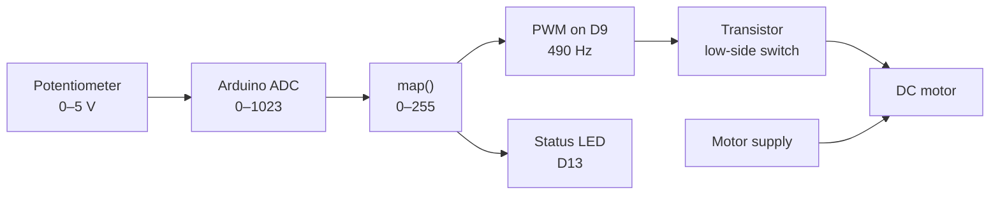
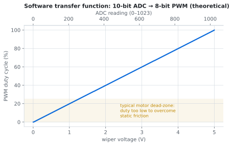

# 🎚️ Potentiometer-Based Transistor Load Control

> Turning a knob into motor speed: a potentiometer feeds the Arduino's ADC, the firmware maps it to a PWM duty cycle, and a transistor switches the motor current that the Arduino pin can't supply.


---

## Contents
1. [Project Overview](#1-project-overview) · 2. [Objective](#2-objective) · 3. [Components](#3-components) · 4. [Working Principle](#4-working-principle) · 5. [Circuit Design](#5-circuit-design) · 6. [Implementation](#6-implementation) · 7. [Source Code](#7-source-code) · 8. [Results](#8-results) · 9. [Challenges](#9-challenges) · 10. [Future Improvements](#10-future-improvements)

---

## 1. Project Overview

This project connects the three basic blocks of almost every control system: **an analog input**, **a digital decision**, and **a power output**.



## 2. Objective

- Read an analog voltage with the microcontroller's ADC.
- Understand why a GPIO pin can't drive a motor directly, and what a transistor does about it.
- Control the *average* power to a load with PWM instead of a variable resistor.
- Protect the circuit from the inductive kickback of a motor.

## 3. Components

| Component | Role | Why |
|---|---|---|
| Arduino Uno | Controller | Reconstructed implementation |
| 10 kΩ potentiometer | Control input | Forms an adjustable voltage divider. 10 kΩ is within the ADC's recommended ≤ 10 kΩ source impedance. |
| TIP120 Darlington NPN | Motor switch | Current gain ≥ 1000, so a few mA from the Arduino controls amps of motor current |
| 1 kΩ resistor | Base resistor | Limits base current to ≈ 3.6 mA, plenty to saturate a TIP120 at motor currents |
| 10 kΩ resistor | Base pull-down | Keeps the motor off while the Arduino boots |
| 220 Ω + red LED | Status indicator | Shows when the output is active |
| 1N4007 diode | Flyback protection | Gives the motor's stored energy a safe path when the transistor turns off |
| DC motor + separate supply | Load | |

> The original build used "a transistor and three resistors". The TIP120 with 1 kΩ (base), 10 kΩ (pull-down) and 220 Ω (LED) is the reconstruction that matches that list. Record the actual part number if you can identify it.

## 4. Working Principle

### 4.1 Input: voltage divider → ADC

The wiper divides 5 V in proportion to its position. The Uno's 10-bit ADC turns 0–5 V into **0–1023**, a resolution of 5 V / 1024 ≈ **4.9 mV per step**.

### 4.2 Processing: 10-bit → 8-bit

`analogWrite()` takes 0–255, so the firmware rescales:

```cpp
int outputValue = map(sensorValue, 0, 1023, 0, 255);
```

<p align="center"></p>

### 4.3 Output: PWM

PWM doesn't produce an in-between voltage. It switches fully ON and fully OFF very quickly (≈ 490 Hz on pin 9), and the **duty cycle** sets the average:

$$V_{avg} = D \times V_{supply}$$

The motor's mechanical inertia smooths the pulses into a steady speed. And because the transistor is always either fully on or fully off, it wastes far less power as heat than linear control would.

### 4.4 Power stage: why a transistor

An Uno pin is rated for about 20 mA (40 mA absolute max). Even a small DC motor draws hundreds of mA, and much more when stalled. The transistor lets that small pin current control the much larger motor current:

$$I_B = \frac{5\,V - V_{BE(Darlington)}}{R_B} \approx \frac{5 - 1.4}{1\,k\Omega} \approx 3.6\ \text{mA}$$

With h<sub>FE</sub> ≥ 1000, that's enough base current to saturate the transistor for several amps of collector current.

## 5. Circuit Design

| From | To |
|---|---|
| Pot outer pins | 5 V and GND |
| Pot wiper | A0 |
| D9 | 1 kΩ → TIP120 Base |
| TIP120 Base | 10 kΩ → GND |
| TIP120 Emitter | GND |
| TIP120 Collector | Motor (–) |
| Motor (+) | Motor supply (+) |
| 1N4007 | across the motor, cathode to supply (+) |
| D13 | 220 Ω → red LED → GND |
| Motor supply GND | Arduino GND (**common ground**) |

```
   Motor V+ ───┬───────────┐
               │           │
             ──┴── 1N4007 (M)
              ▲            │
             ──┬──         │
               └─────┬─────┘
                     │ C
  D9 ──[1kΩ]──┬──────┤ TIP120
              │      │ E
           [10kΩ]    │
              │      │
  GND ────────┴──────┴────── Motor supply GND
```

> **Reconstruction note:** Controller used in the reconstructed implementation: Arduino Uno. Wiring is a reconstruction, not a confirmed historical diagram.

## 6. Implementation

1. Wire the potentiometer and print `analogRead(A0)` to Serial. Confirm it sweeps 0 → 1023 smoothly.
2. Build the transistor stage with an LED + resistor as a stand-in load first, which is safe for testing.
3. Add the flyback diode **before** connecting the motor.
4. Connect the motor to its own supply and tie the grounds together.
5. Sweep the pot and watch the Serial output alongside the motor speed.

## 7. Source Code

📄 [`Code/pot_transistor_control/pot_transistor_control.ino`](Code/pot_transistor_control/pot_transistor_control.ino)

| Line | Purpose |
|---|---|
| `analogRead(POT_PIN)` | 10-bit sample of the wiper voltage |
| `map(..., 0, 1023, 0, 255)` | Rescale ADC range to PWM range |
| `analogWrite(MOTOR_PIN, ...)` | Set duty cycle on D9 (hardware Timer1 PWM) |
| `digitalWrite(STATUS_LED, outputValue > 0)` | LED shows whether the output is active |
| `delay(50)` | ~20 updates/s: responsive to the knob without flooding Serial |

## 8. Results

- Motor speed follows the knob position continuously.
- Serial output shows the ADC reading and PWM value side by side, so the mapping can be checked.
- The Arduino pin only supplies a few mA of base current. The motor current goes through the transistor.

## 9. Challenges

- **Dead zone at low duty.** Below roughly 20–25 % duty, many small motors hum but don't turn, because the average voltage can't overcome static friction. The software mapping is linear, but the motor's response isn't.
- **Darlington voltage drop.** A TIP120 never fully saturates: V<sub>CE(sat)</sub> is about 1–2 V, so the motor gets less than the full supply and the transistor warms up. A logic-level MOSFET avoids this.
- **Audible whine.** 490 Hz is in the audible range, so the motor can whistle at mid duty cycles.

## 10. Future Improvements

- [ ] Map the input to start just above the motor's dead zone, so the whole knob travel does something.
- [ ] Replace the TIP120 with a logic-level MOSFET and compare heat and voltage drop.
- [ ] Raise the PWM frequency above 20 kHz (Timer1 registers) to get rid of the whine.
- [ ] Measure motor current with a shunt resistor or an INA219.
- [ ] Measure RPM with an IR encoder and plot **duty cycle vs RPM**.

## References

See [`References/`](References/).
